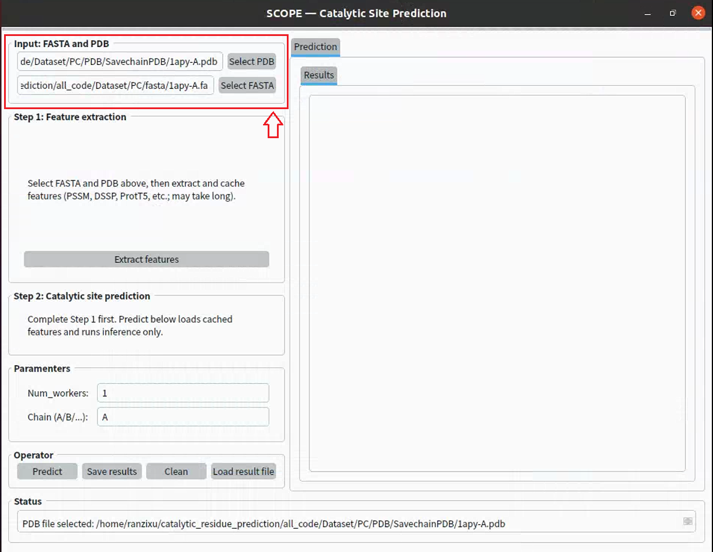
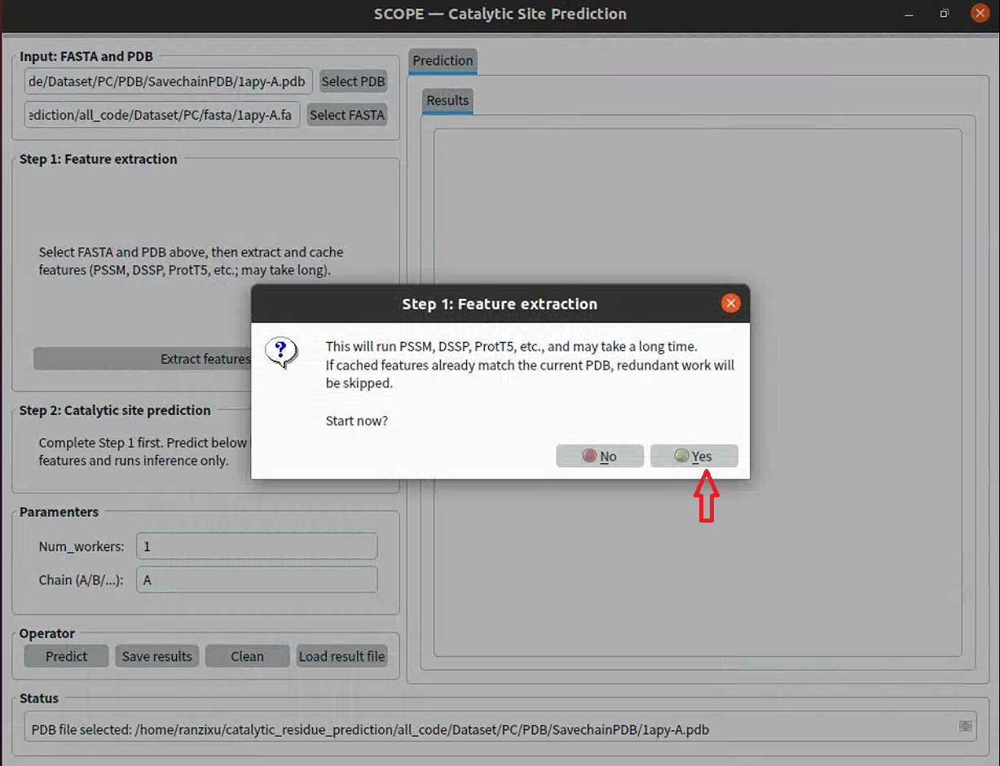

# SCOPE
Accurate identification of enzyme catalytic residues is imperative for comprehending the mechanisms of enzymes, for guiding site-directed mutagenesis experiments, and for designing novel biocatalysts. True de novo prediction of catalytic sites remains challenging, despite the availability of various computational methods, due to the time-consuming and costly nature of experimental identification and the incomplete annotation of catalytic residues. In this study, we propose SCOPE, a deep graph neural network framework for enzyme catalytic site prediction. SCOPE integrates a range of multimodal features, including PSSM, HMM, atomic-level structural descriptors, physicochemical properties of amino acids, and sequence embeddings generated by ProtT5. In order to leverage the spatial clustering properties of catalytic residues, a Gaussian smoothing channel is introduced in order to perform local smoothing and regularization of residue features. The results of the evaluation illustrate that SCOPE attains high accuracy and robustness in the identification of catalytic residues, outperforming existing methods. SCOPE predicts catalytic residues in accordance with biological principles and provides interpretable insights, offering a reliable computational tool for enzyme functional annotation and analysis of catalytic mechanisms. 
# Data
Download the dataset from Hugging Face: <https://huggingface.co/datasets/Biocollab/SCREEN/tree/main>. Extract the downloaded files into the `Dataset` directory.
# Installation
## Environment
Navigate to the `SCOPE` directory and create the environment using: 
```python
conda env create -f environment.yml
```
Then activate the environment:
```python
conda activate scope
```
## Tool description
### BLAST+ for PSSM Profile Generation
#### Download and Installation
BLAST+ is available from the NCBI FTP server: <https://ftp.ncbi.nlm.nih.gov/blast/executables/LATEST/>
#### Documentation
For detailed instructions, please refer to the official NCBI guide: <https://www.ncbi.nlm.nih.gov/books/NBK52640/>
#### Configuration
Before running feature extraction, ensure that the following paths are correctly specified in `feature_extract.py`:
  - `PSIBLAST`: Path to the PSI-BLAST executable
  - `UR90`: Path to the UniRef90 sequence database (The UniRef90 database should be preprocessed using `makeblastdb` prior to use)
### HH-suite for HHM Profile Generation
#### Installation
HH-suite can be installed by following the official instructions: <https://github.com/soedinglab/hh-suite>
#### Database Download
Download the prebuilt UniClust30 database (version 2018_08): <http://wwwuser.gwdg.de/~compbiol/uniclust/2018_08/uniclust30_2018_08_hhsuite.tar.gz>
#### Configuration
Before running feature extraction, configure the following paths in `feature_extract.py`:
  - `HHBLITS`: Path to the HHblits executable
  - `HHDB`: Path to the UniClust30 database (Make sure the UniClust30 database is fully downloaded and properly extracted before use)
### ProtT5 Weights for Evolutionary Embedding
In `evofea_embedding.py`, set the model directory as specified in the comments:
  - MODEL_DIR: Path to the ProtT5 pretrained model weights
Ensure that all required model files are correctly downloaded and placed in the specified directory before running the embedding script.
# Feature Extraction
Navigate to the `SCOPE` directory and run:
```python
python feature_extract.py
```
This step will generate and/or update intermediate feature files, including PSSM profiles, HHM profiles, DSSP structural features, atomic features, contact maps, and sequence-based features; ensure that all required external tools (e.g., BLAST+, HH-suite, DSSP) are properly installed and configured before running it.
# Model Training
(Optional) Set the `LOG_PATH` in `train_deepgcn_with_gaussion_weight.py` as specified in the comments. Start training by running:
```python
python train_deepgcn_with_gaussion_weight.py
```
# Residue Scoring with the SCOPE Model
Run inference using the provided example input (`Example`):
```python
python infer.py
```
The results will be saved to the `InferResult` directory by default.
# GUI (Graphical user interface)
## Introduction
The platform integrates the SCOPE model for enzyme catalytic site prediction. It allows users to upload enzyme PDB structures or FASTA sequences to identify potential catalytic residues and visualize residue-level prediction scores.
## Running Methods
Launch the graphical user interface (GUI) by running:
```python
python SCOPE_GUI_infer.py
```
## Use SCOPE in this platform
After successfully running the `SCOPE_GUI_infer.py` file, you can follow the steps below to use SCOPE on our platform.
### Input Data
- Please upload a PDB file and a FASTA sequence for the enzyme you want to predict!

### Online feature extraction
- Please upload a PDB file and a FASTA sequence for the enzyme you want to predict!

### Predict and save results
### Results display
#### Results Table
#### 3D structure visualization
