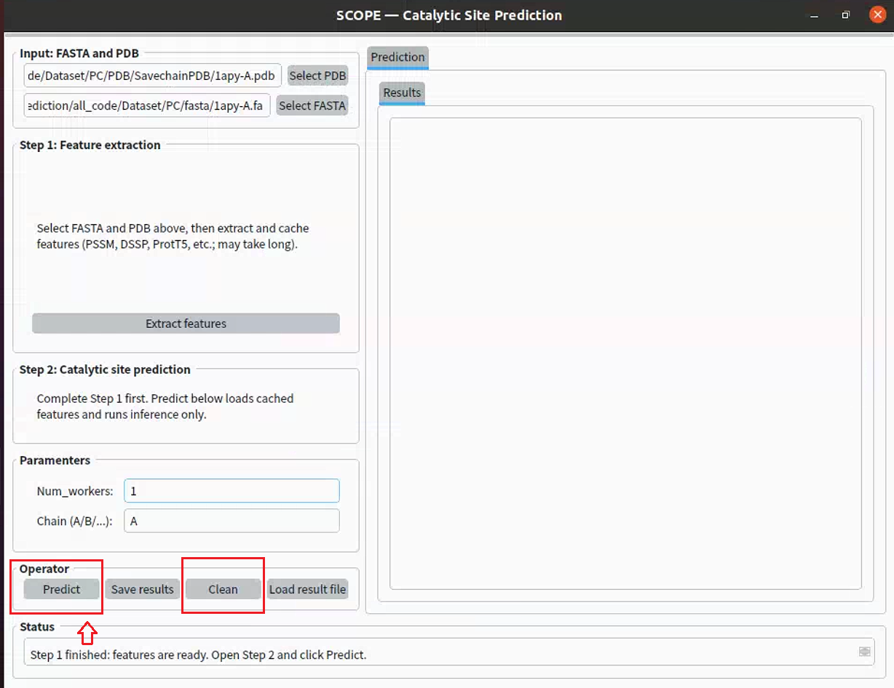

# SCOPE
Accurate identification of catalytic residues is central to understanding enzyme mechanisms and engineering biocatalysts, yet de novo annotation remains challenging because experimentally validated sites are sparse and catalytic function often arises from spatially coordinated residue ensembles rather than isolated sequence positions. Here, we present SCOPE, a spatially smoothed graph learning framework for catalytic residue prediction that integrates evolutionary, physicochemical, and three-dimensional structural information at the residue level. SCOPE represents enzymes as residue-level structural graphs and incorporates a Gaussian smoothing constraint to reinforce locally coherent catalytic signals within active-site microenvironments. Across five independent benchmark datasets, SCOPE consistently outperformed existing sequence- and graph-based methods, with ablation analyses showing the Gaussian smoothing improves recognition of residues embedded in compact catalytic neighbourhoods. Further analyses revealed that enzymes for which SCOPE recovered all annotated catalytic residues while at least one competing method failed are enriched for spatially clustered active sites, particularly hydrolases and EC3.4 peptidases/proteases, and that SCOPE predictions recapitulate the physicochemical, structural and pocket-localisation properties of annotated catalytic residues. We further validated SCOPE prospectively across four low-homology enzymes using site-directed mutagenesis and activity assays, confirming multiple predicted residues as functionally critical. These results establish SCOPE as a robust framework for high-throughput catalytic residue annotation and provide a structure-aware strategy for discovering functional sites in enzymes beyond close homology to known proteins.
# Data
Download the dataset from Hugging Face: <https://huggingface.co/datasets/Biocollab/SCREEN/tree/main>. Extract the downloaded files into the `Dataset` directory.
# Installation
## Environment
Navigate to the `SCOPE` directory and create the environment using: 
```python
conda env create -f environment.yml
```
Then activate the environment:
```python
conda activate scope
```
## Tool description
### BLAST+ for PSSM Profile Generation
#### Download and Installation
BLAST+ is available from the NCBI FTP server: <https://ftp.ncbi.nlm.nih.gov/blast/executables/LATEST/>
#### Documentation
For detailed instructions, please refer to the official NCBI guide: <https://www.ncbi.nlm.nih.gov/books/NBK52640/>
#### Configuration
Before running feature extraction, ensure that the following paths are correctly specified in `feature_extract.py`:
  - `PSIBLAST`: Path to the PSI-BLAST executable
  - `UR90`: Path to the UniRef90 sequence database (The UniRef90 database should be preprocessed using `makeblastdb` prior to use)
### HH-suite for HHM Profile Generation
#### Installation
HH-suite can be installed by following the official instructions: <https://github.com/soedinglab/hh-suite>
#### Database Download
Download the prebuilt UniClust30 database (version 2018_08): <http://wwwuser.gwdg.de/~compbiol/uniclust/2018_08/uniclust30_2018_08_hhsuite.tar.gz>
#### Configuration
Before running feature extraction, configure the following paths in `feature_extract.py`:
  - `HHBLITS`: Path to the HHblits executable
  - `HHDB`: Path to the UniClust30 database (Make sure the UniClust30 database is fully downloaded and properly extracted before use)
### ProtT5 Weights for Evolutionary Embedding
In `evofea_embedding.py`, set the model directory as specified in the comments:
  - MODEL_DIR: Path to the ProtT5 pretrained model weights
Ensure that all required model files are correctly downloaded and placed in the specified directory before running the embedding script.
# Feature Extraction
Navigate to the `SCOPE` directory and run:
```python
python feature_extract.py
```
This step will generate and/or update intermediate feature files, including PSSM profiles, HHM profiles, DSSP structural features, atomic features, contact maps, and sequence-based features; ensure that all required external tools (e.g., BLAST+, HH-suite, DSSP) are properly installed and configured before running it.
# Model Training
(Optional) Set the `LOG_PATH` in `train_deepgcn_with_gaussion_weight.py` as specified in the comments. Start training by running:
```python
python train_deepgcn_with_gaussion_weight.py
```
# Residue Scoring with the SCOPE Model
Run inference using the provided example input (`Example`):
```python
python infer.py
```
The results will be saved to the `InferResult` directory by default.
# GUI (Graphical user interface)
## Introduction
The platform integrates the SCOPE model for enzyme catalytic site prediction. It allows users to upload enzyme PDB structures or FASTA sequences to identify potential catalytic residues and visualize residue-level prediction scores.
## Running Methods
Launch the graphical user interface (GUI) by running:
```python
python SCOPE_GUI_infer.py
```
## Use SCOPE in this platform
After successfully running the `SCOPE_GUI_infer.py` file, you can follow the steps below to use SCOPE on our platform.
### Input Data
- Please upload a PDB file and a FASTA sequence for the enzyme you want to predict!

### Online feature extraction
- Please perform online feature extraction by clicking `Yes` to start; if the corresponding features are already cached, this step will be skipped.

### Predict and save results
- Click the `Predict` button to perform the prediction operation.

- If you want to continue to predict other proteins, please click `Clean` button first.
### Results display
#### Results Table
#### 3D structure visualization
